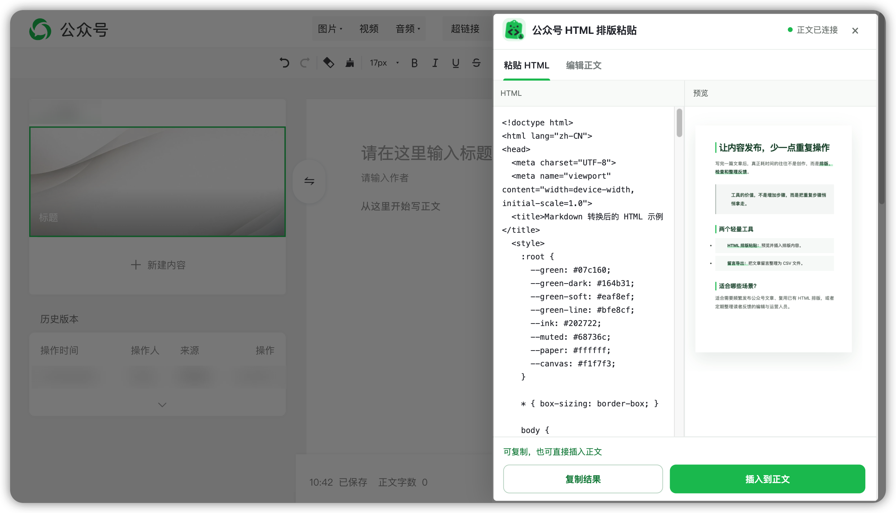
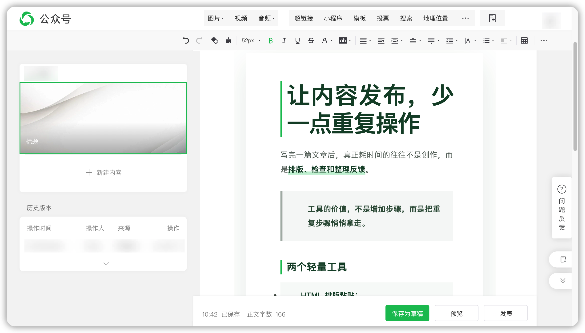
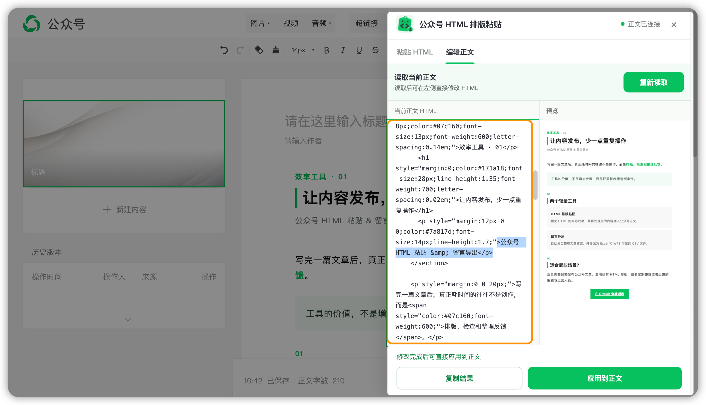

# 公众号 HTML 粘贴 & 留言导出

两个面向微信公众号运营的轻量 Chrome 扩展，帮助你更方便地完成文章排版和留言整理。

**HTML 排版粘贴**：将 HTML 内容转换为富文本，快速插入公众号编辑器。  
**文章留言导出**：批量获取文章留言，导出 CSV 文件，方便统计和分析。

两个工具可独立安装，主要处理流程在本地浏览器完成。

  

## ✍️ 公众号 HTML 排版粘贴

微信公众号编辑器无法直接将 HTML 源代码解析为排版内容。这个扩展可以处理 HTML，并通过富文本粘贴流程，将排版内容写入公众号正文。

**主要功能**

- **HTML 排版转换**：支持公众号常见的 `section + 内联样式` HTML。
- **多种内容适配**：尝试转换普通网页、卡片和 AI 生成的 HTML。
- **快速插入正文**：支持实时预览、复制结果、一键插入。
- **编辑已有文章**：读取当前正文，修改 HTML 后重新应用。

> 💡 适合将 AI 生成的排版、网页文章或已有 HTML 快速放进公众号，也可以在粘贴后继续微调内容和样式。目前支持 HTML 输入，不直接解析原始 Markdown。

### ① 安装扩展

**第一步：下载扩展**

从 GitHub Releases 下载 `wechat-html-layout-paste-v1.0.0.zip`，并解压到本地文件夹。

如果下载的是整个 GitHub 仓库，请使用以下目录：

`extensions/html-layout-paste`

**第二步：安装到 Chrome**

1. 在 Chrome 地址栏输入 `chrome://extensions/`。
2. 打开右上角的「开发者模式」。
3. 点击「加载已解压的扩展程序」。
4. 选择解压后的扩展文件夹（该文件夹内应直接包含 `manifest.json`）。

安装成功后，可以在浏览器工具栏中找到「公众号 HTML 排版粘贴」。

### ② 粘贴 HTML 到公众号

1. 打开微信公众号后台，进入**图文编辑页面**。
2. 点击浏览器工具栏中的「公众号 HTML 排版粘贴」。
3. 在左侧输入框粘贴 HTML，右侧会显示排版预览。
4. 确认效果后，选择一种插入方式：

   - **复制结果**：复制富文本，回到公众号编辑器手动粘贴，方便控制插入位置。
   - **插入到正文**：将内容直接写入当前光标位置，操作更快捷。

**效果预览**

<table>
  <tr>
    <td align="center" width="50%">
      
       
      ① 粘贴 HTML 并预览
    </td>
    <td align="center" width="50%">
      
       
      ② 插入公众号正文
    </td>
  </tr>
</table>

### ③ 修改已有正文

如果已经在公众号编辑器中插入内容，也可以通过扩展重新读取和修改。

1. 在扩展中切换到「编辑正文」。
2. 点击「读取正文」，获取当前公众号文章内容；需要更新时可点击「重新读取」。
3. 在左侧修改 HTML，右侧实时查看预览。
4. 修改完成后，点击「应用到正文」替换当前内容，或选择「复制结果」手动粘贴。

  
   
  读取、修改并重新应用公众号正文

## 💬 微信文章留言导出

在微信公众号后台的文章留言管理页中，自动分页获取当前文章留言，去重后导出为 CSV 文件，方便使用 Excel 或 WPS 进一步分析。

**主要功能**

- **自动识别文章**：获取当前文章的留言数据。
- **批量导出留言**：自动分页获取并去重。
- **完整字段记录**：包含昵称、留言内容、时间、点赞数、IP 地区、精选、置顶及回复等信息。
- **兼容表格工具**：导出 UTF-8 BOM 格式的 CSV，减少中文乱码问题。

> 💡 适合在活动或文章发布后整理读者反馈、筛选高赞留言，或使用 Excel、WPS 继续统计和归档。

### ① 安装扩展

**第一步：下载扩展**

从 GitHub Releases 下载 `wechat-comment-exporter-v1.0.0.zip`，并解压到本地文件夹。

如果下载的是整个 GitHub 仓库，请使用以下目录：

`extensions/comment-exporter`

**第二步：安装到 Chrome**

1. 在 Chrome 地址栏输入 `chrome://extensions/`。
2. 开启「开发者模式」。
3. 点击「加载已解压的扩展程序」。
4. 选择解压后的扩展文件夹（该文件夹内应直接包含 `manifest.json`）。

安装成功后，可以在浏览器工具栏中找到「微信文章留言导出」。

### ② 导出文章留言

1. 登录微信公众号后台，打开需要导出留言的文章留言管理页。
2. 等待留言列表完全加载，通常需要 **2–5 秒**。
3. 点击浏览器工具栏中的「微信文章留言导出」。
4. 确认扩展识别到的文章正确后，点击「导出全部留言」。
5. 等待导出完成，即可在浏览器下载列表中找到 CSV 文件。

**导出效果**

<table>
  <tr>
    <td align="center" width="50%">
      
       
      ① 识别文章并导出留言
    </td>
    <td align="center" width="50%">
      
       
      ② 使用 Excel / WPS 查看数据
    </td>
  </tr>
</table>

### ③ 导出注意事项

**请在留言列表完全加载后再开始导出。**

如果页面已经打开较长时间、切换过文章，或出现 `ret=-1 / system error`，请刷新页面，等待留言重新显示后再尝试。

导出期间请勿重复点击导出按钮、切换文章或关闭扩展弹窗，以免中断操作。

## ⚠️ 已知限制

**HTML 排版**

- 微信公众号编辑器会二次过滤 HTML 和 CSS，复杂动画、伪元素、交互脚本及完整网页布局无法保证保留。
- 外链图片可能受到图片来源或微信平台限制，需要重新上传或配图。

**兼容性**

- 两个扩展均依赖微信公众号后台当前的页面结构或接口行为。
- 如果微信更新后台，部分功能可能需要重新适配。

## 📄 免责声明

本项目为独立开发的第三方工具，与腾讯或微信不存在隶属、授权或合作关系。

发布文章或使用导出数据前，请自行复核结果，并遵守相关平台规则及隐私要求。
