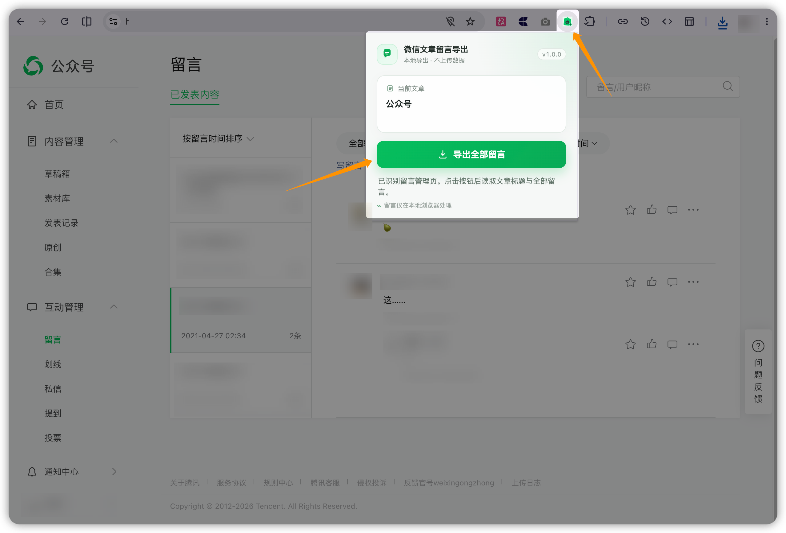
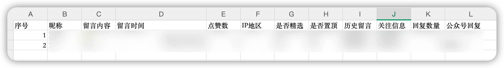

# 公众号 HTML 粘贴 & 留言导出

一组面向微信公众号编辑与运营的轻量 Chrome 扩展，包含两个相互独立的工具：将常见 HTML 转换并写入公众号正文，以及将文章留言导出为 CSV。

两个扩展均基于 Manifest V3，不需要后端服务，不包含统计 SDK，核心数据只在当前浏览器中处理。

> 当前版本：两个扩展均为 `1.0.0`

> 📷 **截图待补 1：工具箱总览**  
> 建议拍摄 Chrome 扩展管理页中两个扩展并排显示的画面，保存为 `docs/images/extensions-overview.png`，然后取消下面图片代码的注释。

<!--  -->

## 包含的工具

### 1. 公众号 HTML 排版粘贴

把常见文章 HTML、完整网页 HTML 和卡片式 HTML 转换为更适合微信公众号编辑器的内联样式结构，并支持预览、复制、插入正文以及读取和修改现有正文。

主要能力：

- 将 `<style>` 中的常见 CSS 规则转换为内联样式
- 将固定宽度、Flex、Grid 和绝对定位内容尽量转换为公众号流式结构
- 保留常见文字、图片、链接、SVG 和小程序素材结构
- 按公众号正文宽度缩略预览
- 在光标位置插入处理结果
- 读取、修改并替换当前公众号正文
- 自动写入失败时复制结果，允许手动粘贴

项目目录：[`extensions/html-layout-paste`](extensions/html-layout-paste)

> 📷 **截图待补 2：HTML 排版粘贴主界面**  
> 建议同时包含左侧 HTML 编辑区、右侧缩略预览和底部“插入到正文”按钮，保存为 `docs/images/html-layout-paste.png`。

<!--  -->

> 📷 **截图待补 3：应用前后对比**  
> 建议制作一张左右对比图：左侧为原始 HTML，右侧为公众号编辑器中的结果，保存为 `docs/images/html-before-after.png`。

<!--  -->

### 2. 微信文章留言导出

在微信公众号后台的文章留言管理页中，分页获取当前文章的全部留言，去重后导出为适合 Excel 和 WPS 打开的 CSV 文件。

主要能力：

- 自动识别当前留言管理页和文章标题
- 自动分页获取全部留言并去重
- 导出昵称、内容、时间、点赞数、IP 地区、精选、置顶和回复等字段
- 使用 UTF-8 BOM，减少 Excel/WPS 中文乱码问题
- 自动清理文件名中的非法字符
- 复用当前公众号后台登录态，无需填写 Cookie、token 或其他参数

项目目录：[`extensions/comment-exporter`](extensions/comment-exporter)

> 📷 **截图待补 4：留言导出弹窗**  
> 建议使用一篇测试文章，展示已识别文章标题和“导出全部留言”按钮；截图中不要出现真实账号、token 或敏感留言，保存为 `docs/images/comment-exporter.png`。

<!--  -->

> 📷 **截图待补 5：CSV 导出结果**  
> 建议使用虚构测试数据，在 Excel 或 WPS 中展示字段和中文效果，保存为 `docs/images/comment-csv.png`。

<!--  -->

## 安装

这两个工具是两个独立扩展，需要分别加载。不要选择仓库根目录，也不要选择 `extensions` 目录。

1. 下载本仓库并解压，或执行 `git clone`。
2. 打开 Chrome 的 `chrome://extensions/`。
3. 开启右上角的“开发者模式”。
4. 点击“加载已解压的扩展程序”。
5. 安装 HTML 工具时，选择：

   ```text
   extensions/html-layout-paste
   ```

6. 再次点击“加载已解压的扩展程序”，安装留言导出工具时选择：

   ```text
   extensions/comment-exporter
   ```

7. 建议将两个扩展固定到浏览器工具栏。

每个扩展目录都有自己的 `manifest.json`，可独立安装、更新和卸载。

## 使用方法

### 排版或修改 HTML

1. 打开微信公众号后台图文编辑页面。
2. 把光标放到计划插入内容的位置。
3. 点击“公众号 HTML 排版粘贴”图标。
4. 粘贴 HTML，检查缩略预览。
5. 点击“插入到正文”；也可以先“复制结果”再手动粘贴。
6. 如需修改现有文章，切换到“编辑正文”，读取后修改并点击“应用到正文”。

### 导出文章留言

1. 登录微信公众号后台并打开某篇文章的留言管理页。
2. 等待页面中的留言列表加载完成。
3. 点击“微信文章留言导出”图标。
4. 确认识别到正确文章后，点击“导出全部留言”。
5. 导出期间不要关闭弹窗；完成后在浏览器下载列表中查看 CSV。

## 项目结构

```text
wechat-mp-toolkit/
├── README.md
├── .gitignore
├── docs/
│   └── images/                       # README 截图
└── extensions/
    ├── html-layout-paste/            # 独立扩展 1
    │   ├── manifest.json
    │   ├── background.js
    │   ├── transformer.js
    │   ├── content.js
    │   ├── README.md
    │   └── icon*.png
    └── comment-exporter/             # 独立扩展 2
        ├── manifest.json
        ├── popup.html
        ├── popup.css
        ├── popup.js
        ├── README.md
        └── icons/
```

项目不需要构建步骤或第三方依赖，可直接检查和加载源码。

## 权限与隐私

### HTML 排版粘贴

- `activeTab`：仅在用户点击扩展后临时访问当前标签页
- `scripting`：将本地转换脚本和操作面板加载到当前公众号页面
- `clipboardWrite`：在用户主动点击复制按钮后写入富文本剪贴板

### 留言导出

- `activeTab`：仅在用户点击扩展后临时访问当前留言页面
- `scripting`：在当前公众号页面执行本地留言获取逻辑

两个扩展均不包含账号系统、广告、统计 SDK、远程代码或自建服务器，不会把文章正文、留言、Cookie 或 token 上传给第三方。留言导出工具会在当前页面内存中复用微信后台已经发出的同源留言请求地址；该地址不会被保存或上报。

## 已知限制

- 依赖微信公众号后台当前的页面结构与接口行为，微信更新后台后可能需要适配。
- 微信编辑器会二次过滤 HTML 和 CSS，复杂动画、伪元素、交互脚本及完整网页布局无法保证保留。
- 外链图片能否长期显示取决于图片来源和微信的图片处理策略。
- 留言导出必须在留言管理页使用，并依赖当前有效的公众号后台登录态。
- 发布文章或使用导出数据前，请自行复核结果并遵守相关平台规则和隐私要求。

## 开发与贡献

欢迎提交 Issue 或 Pull Request。反馈问题时请提供：

- 浏览器版本和扩展版本
- 使用的功能与复现步骤
- 已脱敏的错误提示或截图

请勿提交公众号 Cookie、token、未公开文章、真实留言或其他个人信息。

## 发布约定

两个扩展独立发布和打包：

- `wechat-html-layout-paste-v1.0.0.zip`
- `wechat-comment-exporter-v1.0.0.zip`

每个 ZIP 解压后，其根目录应直接包含该扩展自己的 `manifest.json`。不要把两个扩展打进同一个可安装 ZIP，也不要在扩展 ZIP 外再套一层同名文件夹。

## 许可证

> TODO：发布前添加 `LICENSE` 文件，并在这里写明最终许可证。若希望允许他人自由使用、修改和分发，同时保留署名与免责条款，可以考虑 MIT License。

## 免责声明

本项目是独立开发的第三方工具，与腾讯或微信不存在隶属、授权或合作关系。“微信”“微信公众号”等名称仅用于说明工具的适用场景。

